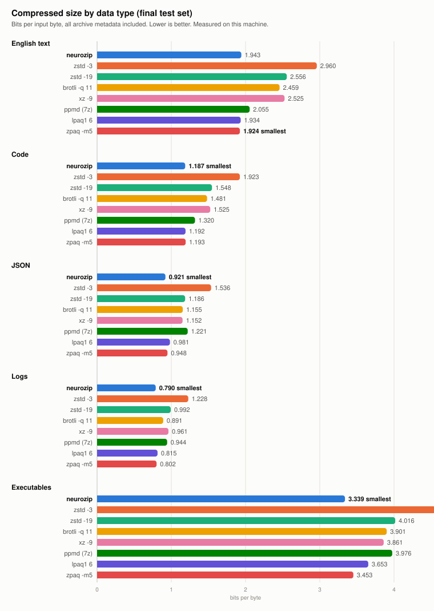
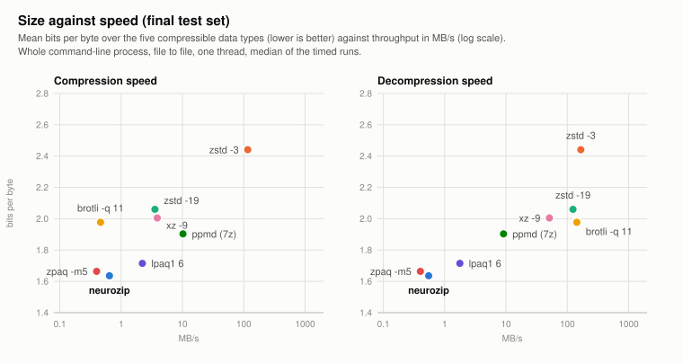
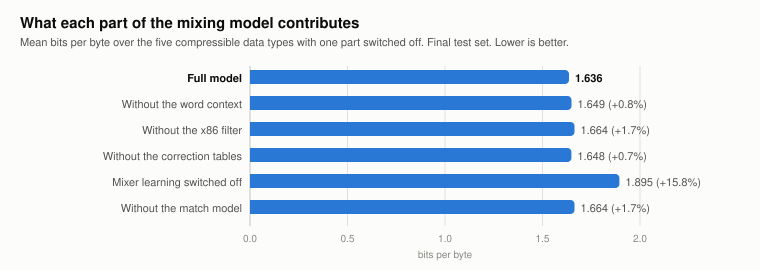

# NeuroZip benchmark report

Generated by `bench/make_report.py` from the files in `bench/results/` (final-set run of 2026-11-23T20:08:16Z). Every number below is computed from those files.

## Summary

**What was tested.** NeuroZip's default model: bit-level context mixing. Each context keeps a counter and a short bit history; a match model follows long repeats; an x86 filter is applied to blocks that look like machine code; and a small two-layer linear mixer, trained online in integer arithmetic with no stored weights, combines the predictions. It is compared with four classical configurations (zstd -3, zstd -19, Brotli, xz) and with three compressors of its own kind (PPMd, lpaq1, zpaq). **No MLP or other deeper neural predictor has been built**; the learned part is the linear mixer only.

The headline numbers come from the **final test set** of 14 files, assembled after this model and its constants were fixed, and run once. The two earlier test sets are reported separately below.

**Against the classical compressors: smaller, much slower.**

* Mean bits per byte over the five compressible data types: NeuroZip 1.636, best classical (`brotli -q 11`) 1.977. NeuroZip is 17.3% lower.
* By data type against the best classical tool: English text 21.0% lower; Code 19.9% lower; JSON 20.0% lower; Logs 11.3% lower; Executables 13.5% lower.
* By file it is smaller than every classical tool on 11 of the 11 compressible files.
* It decompresses at 0.5 MB/s; `xz -9` at 51.0 MB/s and `zstd -19` at 124 MB/s, roughly 92 and 225 times faster. It needs about 182 MiB to decompress; the classical tools need 10 MiB or less.

**Against its own kind.**

* `zpaq -m5`: 1.664 bits per byte, 1.7% above NeuroZip; compresses at 0.4 MB/s, decompresses at 0.4 MB/s, 181 MiB.
* `lpaq1 6`: 1.715 bits per byte, 4.8% above NeuroZip; compresses at 2.2 MB/s, decompresses at 1.8 MB/s, 168 MiB.
* `ppmd (7z)`: 1.903 bits per byte, 16.3% above NeuroZip; compresses at 10.2 MB/s, decompresses at 9.1 MB/s, 69 MiB.
* NeuroZip is the smallest of all nine configurations on 8 of the 11 compressible files.

So NeuroZip ranks first of nine on mean size on this set. Smaller than it: none. Larger: `zpaq -m5`, `lpaq1 6`, `ppmd (7z)`, `brotli -q 11`, `xz -9`, `zstd -19`, `zstd -3`.

**What this does and does not show.** Every technique in the model is established in the PAQ, lpaq and zpaq line of compressors (see `docs/PRIOR_ART.md`); nothing here is claimed as a new algorithm. The comparison covers lpaq1 at one level and zpaq at its strongest standard method. The strongest compressors of this kind (cmix, the PAQ8 family) were not run and are expected to produce smaller files than anything in this report, at much lower speed.

**One check against cmix.** cmix version 21 (Homebrew) was run on a single file of this set, `json_apache_builds.json` (127,275 bytes). It produced 4,397 bytes; NeuroZip produced 5,952, which is 35% larger. cmix took 286 seconds of CPU time and 8.6 GiB of memory for that file. This is one file, compressed only (not decompressed to verify), but it is direct evidence that NeuroZip is not the best available compressor on size.

## What these numbers are

* **Local measurements**, not estimates: every size is a real output file and every time is a real process, on one machine. Nothing here is extrapolated. Results on other hardware or other files will differ.
* **Machine:** Apple M5 Pro, 18 logical CPUs, 48 GiB RAM, Darwin 27.2.1 (arm64).
* **Tools:** neurozip 0.1.0 (mix model: hash bits 18, match window 2^22, block 256 KiB; ctx model: order 4, hash bits 20, block 256 KiB); Zstandard CLI (64-bit) v1.5.7, by Yann Collet; brotli 1.2.1; xz (XZ Utils) 5.8.4; 7-Zip (z) 26.06 (arm64) (PPMd, `-mx=9`); zpaq 7.15, method 5; lpaq1 (Matt Mahoney, 2007), level 6, built from source with c++ -O2. All single-threaded.
* **Size:** size of the output file, all headers and checksums included. 7-Zip and zpaq archives also store the file name and attributes; those bytes are counted.
* **Time:** median wall time of whole CLI process, file to file, one run at a time; 3 runs each.
* **Memory:** peak resident set size of the process (wait4). **CPU:** user + system CPU time of the process (wait4).
* **Power:** not measured (needs root-only powermetrics on macOS). CPU time is the nearest available proxy.
* **Verification:** every compressed file was decompressed and matched the original's SHA-256.
* Files are capped at 4 MiB, which is small. Behaviour on large inputs is not measured.
* Throughput for the fast tools on files this small includes process start-up, so it understates them.
* **The machine was not idle.** Other jobs were running during these runs, so every throughput figure here is lower than on a quiet machine (by roughly a factor of two for the final set, judging by tools measured earlier) and the ratios between tools are only approximate. Sizes are not affected.
* lpaq1 was run at level 6 (195 MB of tables), the level closest to NeuroZip's memory; it has higher levels. zpaq and PPMd were run at their strongest standard settings. cmix was not run (hours per file, tens of gigabytes of memory).

## Ranking (final test set)

Ranked by mean bits per byte over the five compressible data types, each type weighted equally.

| Rank | Compressor | Kind | Mean bpb (5 types) | Bytes (5 types) | Compress MB/s | Decompress MB/s | Compress MiB | Decompress MiB |
| ---: | --- | --- | ---: | ---: | ---: | ---: | ---: | ---: |
| 1 | **`neurozip`** | context modelling | 1.636 | 3,589,660 | 0.6 | 0.5 | 181 | 182 |
| 2 | `zpaq -m5` | context modelling | 1.664 | 3,680,416 | 0.4 | 0.4 | 181 | 181 |
| 3 | `lpaq1 6` | context modelling | 1.715 | 3,834,235 | 2.2 | 1.8 | 168 | 168 |
| 4 | `ppmd (7z)` | context modelling | 1.903 | 4,254,698 | 10.2 | 9.1 | 70 | 69 |
| 5 | `brotli -q 11` | classical | 1.977 | 4,208,535 | 0.5 | 143 | 87 | 7 |
| 6 | `xz -9` | classical | 2.005 | 4,268,180 | 3.9 | 51.0 | 103 | 6 |
| 7 | `zstd -19` | classical | 2.060 | 4,416,023 | 3.6 | 124 | 60 | 10 |
| 8 | `neurozip ctx` | context modelling | 2.379 | 5,492,090 | 2.0 | 1.7 | 99 | 99 |
| 9 | `zstd -3` | classical | 2.441 | 5,177,858 | 116 | 166 | 12 | 7 |

Speed is over the compressible files; memory is the peak for any file.

## Size by data type (final test set)



| Bits per byte | `neurozip` | `zstd -3` | `zstd -19` | `brotli -q 11` | `xz -9` | `ppmd (7z)` | `lpaq1 6` | `zpaq -m5` | `neurozip ctx` |
| --- | ---: | ---: | ---: | ---: | ---: | ---: | ---: | ---: | ---: |
| English text | 1.943 | 2.960 | 2.556 | 2.459 | 2.525 | 2.055 | 1.934 | **1.924** | 2.278 |
| Code | **1.187** | 1.923 | 1.548 | 1.481 | 1.525 | 1.320 | 1.192 | 1.193 | 1.719 |
| JSON | **0.921** | 1.536 | 1.186 | 1.155 | 1.152 | 1.221 | 0.981 | 0.948 | 1.624 |
| Logs | **0.790** | 1.228 | 0.992 | 0.891 | 0.961 | 0.944 | 0.815 | 0.802 | 1.450 |
| Executables | **3.339** | 4.559 | 4.016 | 3.901 | 3.861 | 3.976 | 3.653 | 3.453 | 4.825 |
| Compressed | **7.977** | 8.000 | 7.987 | 8.000 | 7.991 | 8.177 | 7.994 | 7.985 | 8.001 |
| Random | 8.001 | 8.000 | 8.000 | **8.000** | 8.001 | 8.171 | 8.011 | 8.009 | 8.001 |

Smallest in each row is bold. On the last two rows almost nothing compresses.

## Speed, CPU and memory (final test set)



| Compressor | Compress MB/s | Decompress MB/s | Compress CPU s/MB | Decompress CPU s/MB | Compress peak MiB | Decompress peak MiB |
| --- | ---: | ---: | ---: | ---: | ---: | ---: |
| `neurozip` | 0.6 | 0.5 | 1.529 | 1.8195 | 181 | 182 |
| `zstd -3` | 116 | 166 | 0.007 | 0.0047 | 12 | 7 |
| `zstd -19` | 3.6 | 124 | 0.279 | 0.0054 | 60 | 10 |
| `brotli -q 11` | 0.5 | 143 | 2.102 | 0.0053 | 87 | 7 |
| `xz -9` | 3.9 | 51.0 | 0.238 | 0.0159 | 103 | 6 |
| `ppmd (7z)` | 10.2 | 9.1 | 0.096 | 0.1081 | 70 | 69 |
| `lpaq1 6` | 2.2 | 1.8 | 0.449 | 0.5638 | 168 | 168 |
| `zpaq -m5` | 0.4 | 0.4 | 2.512 | 2.4885 | 181 | 181 |
| `neurozip ctx` | 2.0 | 1.7 | 0.495 | 0.5776 | 99 | 99 |

NeuroZip, lpaq1 and zpaq decompress about as slowly as they compress, because the decoder has to re-run the same model. That is inherent to the approach.

## Per-file results (final test set)

| File | Original bytes | `neurozip` | `zstd -3` | `zstd -19` | `brotli -q 11` | `xz -9` | `ppmd (7z)` | `lpaq1 6` | `zpaq -m5` | `neurozip ctx` |
| --- | ---: | ---: | ---: | ---: | ---: | ---: | ---: | ---: | ---: | ---: |
| `text_sherlock_holmes.txt` | 607,504 | 144,769 | 223,164 | 190,972 | 183,982 | 188,884 | 150,302 | 144,376 | **143,509** | 170,848 |
| `text_frankenstein.txt` | 421,633 | 105,157 | 157,568 | 137,797 | 132,325 | 135,996 | 114,068 | 104,472 | **103,994** | 122,218 |
| `code_zlib.c` | 332,169 | **49,125** | 79,795 | 64,753 | 61,478 | 63,508 | 56,193 | 49,214 | 49,569 | 70,805 |
| `code_click.py` | 555,457 | **82,532** | 133,571 | 107,004 | 102,867 | 105,648 | 90,217 | 83,013 | 82,771 | 119,890 |
| `json_mesh.json` | 723,597 | **121,497** | 183,229 | 144,611 | 142,764 | 141,740 | 161,548 | 127,848 | 122,024 | 205,913 |
| `json_apache_builds.json` | 127,275 | **5,952** | 12,283 | 9,874 | 9,303 | 9,908 | 8,429 | 6,321 | 7,591 | 12,969 |
| `json_random.json` | 510,476 | **29,281** | 65,894 | 47,344 | 44,430 | 44,368 | 37,756 | 32,844 | 31,777 | 57,438 |
| `logs_zeek_dns.log` | 4,194,304 | **282,477** | 473,514 | 361,682 | 321,650 | 355,520 | 361,343 | 299,846 | 295,965 | 626,907 |
| `logs_zeek_ssl.log` | 4,194,304 | 546,130 | 814,283 | 678,530 | 612,602 | 652,604 | 628,116 | 554,428 | **544,877** | 893,478 |
| `exe_busybox_linux_x64` | 1,131,168 | **513,838** | 737,764 | 647,919 | 633,519 | 624,368 | 615,279 | 572,469 | 542,748 | 732,145 |
| `exe_bat_linux_x64` | 4,194,304 | **1,708,902** | 2,296,793 | 2,025,537 | 1,963,615 | 1,945,636 | 2,031,447 | 1,859,404 | 1,755,591 | 2,479,479 |
| `compressed_zlib.tar.gz` | 1,572,744 | **1,568,140** | 1,572,793 | 1,569,544 | 1,572,752 | 1,570,608 | 1,604,733 | 1,571,154 | 1,569,200 | 1,572,882 |
| `compressed_click.tar.gz` | 341,625 | **340,698** | 341,647 | 341,647 | 341,633 | 341,700 | 352,037 | 341,890 | 341,606 | 341,711 |
| `random_shake256_c.bin` | 2,097,152 | 2,097,316 | 2,097,213 | 2,097,213 | **2,097,160** | 2,097,320 | 2,141,903 | 2,100,070 | 2,099,604 | 2,097,316 |

## The earlier test sets

No constant was ever tuned on either of these sets, but both had been looked at before the current model was built, so neither is a clean test of it. The second set's results for the previous model showed where it was weakest; the first set prompted the match model. They are shown for comparison.

### Second test set (14 files)

| Rank | Compressor | Kind | Mean bpb (5 types) | Bytes (5 types) | Compress MB/s | Decompress MB/s | Compress MiB | Decompress MiB |
| ---: | --- | --- | ---: | ---: | ---: | ---: | ---: | ---: |
| 1 | **`neurozip`** | context modelling | 1.350 | 3,108,138 | 0.4 | 0.4 | 181 | 181 |
| 2 | `zpaq -m5` | context modelling | 1.361 | 3,139,188 | 0.3 | 0.3 | 179 | 181 |
| 3 | `lpaq1 6` | context modelling | 1.425 | 3,275,440 | 1.2 | 1.0 | 168 | 168 |
| 4 | `ppmd (7z)` | context modelling | 1.589 | 3,651,218 | 8.8 | 7.1 | 69 | 68 |
| 5 | `brotli -q 11` | classical | 1.683 | 3,809,086 | 0.4 | 140 | 69 | 8 |
| 6 | `xz -9` | classical | 1.697 | 3,870,300 | 3.4 | 50.9 | 103 | 6 |
| 7 | `zstd -19` | classical | 1.759 | 4,017,931 | 2.4 | 169 | 60 | 9 |
| 8 | `neurozip ctx` | context modelling | 2.069 | 4,920,027 | 1.4 | 1.5 | 99 | 99 |
| 9 | `zstd -3` | classical | 2.149 | 4,910,022 | 113 | 172 | 12 | 8 |

| Bits per byte | `neurozip` | `zstd -3` | `zstd -19` | `brotli -q 11` | `xz -9` | `ppmd (7z)` | `lpaq1 6` | `zpaq -m5` | `neurozip ctx` |
| --- | ---: | ---: | ---: | ---: | ---: | ---: | ---: | ---: | ---: |
| English text | 1.898 | 2.938 | 2.489 | 2.425 | 2.465 | 2.043 | 1.891 | **1.878** | 2.238 |
| Code | 1.040 | 1.823 | 1.382 | 1.339 | 1.364 | 1.183 | 1.045 | **1.026** | 1.642 |
| JSON | 0.669 | 1.213 | 0.898 | 0.853 | 0.881 | 0.887 | 0.710 | **0.668** | 1.286 |
| Logs | **1.031** | 1.547 | 1.294 | 1.198 | 1.256 | 1.134 | 1.044 | 1.037 | 1.606 |
| Executables | **2.111** | 3.222 | 2.732 | 2.597 | 2.520 | 2.699 | 2.434 | 2.195 | 3.572 |
| Compressed | 7.945 | 7.999 | 7.952 | **7.943** | 7.953 | 8.111 | 7.961 | 7.949 | 7.999 |
| Random | 8.001 | 8.000 | 8.000 | **8.000** | 8.001 | 8.170 | 8.011 | 8.010 | 8.001 |

NeuroZip's mean is 1.350 and its rank is 1 of nine on this set.

## Ablations (final test set)

Sizes from `neurozip ablate`, all metadata included. The mixing-model variants are selected by switches stored in the archive header, so each one is a real, decodable archive. "Fallback disabled" and the context model's "frozen" variant are size measurements only: the format cannot express them.



| Variant (bits per byte) | English text | Code | JSON | Logs | Executables | Compressed | Random | Mean of first 5 |
| --- | ---: | ---: | ---: | ---: | ---: | ---: | ---: | ---: |
| Full model | 1.943 | 1.187 | 0.921 | 0.790 | 3.339 | 7.977 | 8.001 | 1.636 |
| Without the word context | 1.977 | 1.211 | 0.922 | 0.790 | 3.344 | 7.977 | 8.001 | 1.649 |
| Without the x86 filter | 1.943 | 1.187 | 0.921 | 0.790 | 3.479 | 7.977 | 8.001 | 1.664 |
| Without the correction tables | 1.960 | 1.198 | 0.926 | 0.800 | 3.355 | 7.970 | 8.001 | 1.648 |
| Mixer learning switched off | 2.195 | 1.468 | 1.117 | 0.970 | 3.723 | 8.001 | 8.001 | 1.895 |
| Without the match model | 1.950 | 1.245 | 0.933 | 0.812 | 3.380 | 7.977 | 8.001 | 1.664 |
| Model reset at every 256 KiB block | 2.084 | 1.274 | 0.925 | 0.887 | 3.521 | 7.976 | 8.001 | 1.738 |
| Stored fallback disabled | 1.943 | 1.187 | 0.921 | 0.790 | 3.339 | 7.978 | 8.014 | 1.636 |
| Byte-level context model (`neurozip ctx`) | 2.278 | 1.719 | 1.624 | 1.450 | 4.825 | 8.001 | 8.001 | 2.379 |
| No model (everything stored) | 8.001 | 8.002 | 8.002 | 8.001 | 8.001 | 8.001 | 8.001 | 8.001 |

* **Match model:** removing it costs 1.7% on the mean and most on Code (1.187 to 1.245).
* **Online-trained mixer:** with learning switched off the predictors are combined with fixed equal weights, and the mean rises 15.8%. This is the measured value of the learned combination over a fixed one.
* **Correction tables:** 0.7%. **Word context:** 0.8% on the mean, 1.8% on English text.
* **Carrying the model across blocks:** resetting every block raises the mean from 1.636 to 1.738.
* **Fallback:** it matters only for incompressible input. Without it random data costs 8.014 bits per byte instead of 8.001. The only fallback that exists is "stored"; fallback to a classical codec has not been built.

### Baseline context model: highest order

| Highest order | English text | Code | JSON | Logs | Executables | Mean |
| --- | ---: | ---: | ---: | ---: | ---: | ---: |
| 0 | 4.557 | 4.623 | 4.348 | 4.959 | 6.293 | 4.956 |
| 1 | 3.432 | 3.429 | 2.657 | 3.370 | 5.238 | 3.625 |
| 2 | 2.945 | 2.468 | 1.761 | 2.227 | 5.007 | 2.881 |
| 3 | 2.464 | 1.896 | 1.612 | 1.680 | 4.885 | 2.507 |
| 4 (default) | 2.278 | 1.719 | 1.624 | 1.450 | 4.825 | 2.379 |
| 5 | 2.281 | 1.666 | 1.578 | 1.385 | 4.803 | 2.342 |
| 6 | 2.355 | 1.652 | 1.469 | 1.350 | 4.795 | 2.324 |

With that model's learning frozen after the first 10% of each file the mean rises from 2.379 to 3.389.

### Status of the requested ablations

| Ablation requested | Status |
| --- | --- |
| Context only | Done: the byte-level context model, and its order sweep |
| Neural only | Not run. The only learned component is the linear mixer, which has no prediction of its own without the context inputs. A stand-alone neural predictor (MLP) has not been built |
| Ensemble | Done: the full mixing model, against the same model with mixer learning off |
| Fallback | Done for stored fallback; classical-codec fallback has not been built |
| Adaptive learning disabled | Done: mixer learning off (mixing model) and counts frozen (context model) |

## Leakage controls

* No model has trained weights: encoder and decoder start from a fixed initial state and learn only from the file being compressed. There is no training set to leak from.
* The remaining risk is tuning and design choices. The model's constants (counter limits, mixer learning rates, initial weights, correction-table rate) and its choice of contexts were settled on a separate development set (`bench/dev.lock.json`).
* The final test set (`bench/corpora3.lock.json`) was assembled after that, from books, projects, JSON files, log files and binaries that appear in no other set. The full benchmark was run on it once and the results are reported as they came out. One file (`json_apache_builds.json`) was compressed once beforehand to check that the benchmark pipeline worked; nothing was changed afterwards.
* The two earlier test sets (`bench/corpora2.lock.json`, `bench/corpora.lock.json`) had been seen before this model was built, as described above, and are reported separately for that reason.
* Final test set files:

| File | Type | Source | Bytes | Extent |
| --- | --- | --- | ---: | --- |
| `text_sherlock_holmes.txt` | English text | Project Gutenberg #1661 (pglaf.org mirror) | 607,504 | whole file |
| `text_frankenstein.txt` | English text | Project Gutenberg #84 (pglaf.org mirror) | 421,633 | whole file |
| `code_zlib.c` | Code | zlib 1.3.1, top-level *.c concatenated in name order | 332,169 | whole file |
| `code_click.py` | Code | click 8.1.7, all *.py concatenated in name order | 555,457 | whole file |
| `json_mesh.json` | JSON | simdjson-data jsonexamples/mesh.json | 723,597 | whole file |
| `json_apache_builds.json` | JSON | simdjson-data jsonexamples/apache_builds.json | 127,275 | whole file |
| `json_random.json` | JSON | simdjson-data jsonexamples/random.json | 510,476 | whole file |
| `logs_zeek_dns.log` | Logs | brimdata zed-sample-data zeek-default/dns.log | 4,194,304 | first 4 MiB of 10,100,621 |
| `logs_zeek_ssl.log` | Logs | brimdata zed-sample-data zeek-default/ssl.log | 4,194,304 | first 4 MiB of 7,157,250 |
| `exe_busybox_linux_x64` | Executables | busybox 1.35.0 Linux x86-64 musl binary | 1,131,168 | whole file |
| `exe_bat_linux_x64` | Executables | bat 0.24.0 Linux x86-64 musl binary | 4,194,304 | first 4 MiB of 5,770,456 |
| `compressed_zlib.tar.gz` | Compressed | zlib 1.3.1 source tarball (gzip) | 1,572,744 | whole file |
| `compressed_click.tar.gz` | Compressed | click 8.1.7 source tarball (gzip) | 341,625 | whole file |
| `random_shake256_c.bin` | Random | SHAKE-256 output from a fourth fixed seed | 2,097,152 | whole file |

## Limits of this benchmark

* One machine, one run of the suite, 3 timed repetitions per measurement.
* Two or three files per data type in each set, each at most 4 MiB. Differences of a few percent between neighbouring compressors could change with other files.
* Power was not measured.
* The stronger members of this class were not all run: cmix and the larger PAQ8 variants are expected to produce smaller files than anything here, at far lower speed.
* The classical tools were run at their strongest standard presets but without extras such as xz's x86 filter or Brotli's large-window mode.

## Reproduce

```
cargo build --release
python3 bench/fetch_corpora.py   # downloads and checks the pinned files
sh bench/build_tools.sh          # builds lpaq1; install zstd, brotli, xz, 7zz, zpaq separately
python3 bench/run_bench.py --sets final --output final.json
python3 bench/run_bench.py --sets fresh --skip-ablations --output fresh.json
python3 bench/run_bench.py --sets first --skip-ablations --output first.json
python3 bench/make_report.py     # writes this report and docs/charts/
```
